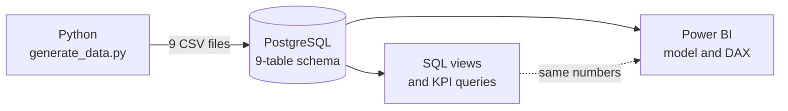
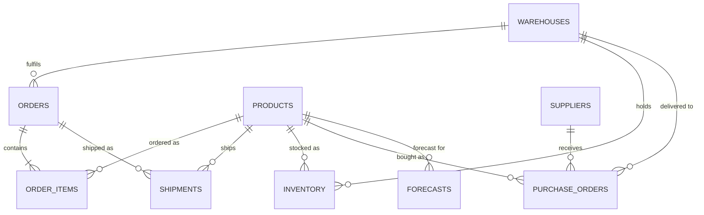

# Supply Chain Performance Command Center

An end-to-end supply-chain analytics project: Python generates a year of realistic operations data, PostgreSQL models it, SQL calculates the KPIs, and Power BI reports them.


## The problem

Supply-chain managers need to know four things quickly: are customer orders arriving on time and complete, which suppliers are slowing us down, where stock is about to run out, and how far off the demand forecast is. This data usually sits in separate systems. This project brings it into one model with one set of KPI definitions.

**What it helps a manager do:**
- See OTIF and fill rate by month, region and warehouse
- Rank suppliers by on-time delivery, lateness and a composite score
- Find locations below their reorder point or with less than 7 days of stock left
- Track forecast error by product and category

## How it works



1. **Generate:** `data/generate_data.py` creates the data with a fixed seed, so every run produces identical files. Statuses are derived from dates as of 31 Dec 2025, so a cancelled order never ships and a delivered shipment always has a delivery date.
2. **Model:** `sql/schema.sql` creates 9 tables with primary and foreign keys.
3. **Load:** `sql/load_csvs.py` loads the CSVs in one transaction, so it is safe to re-run.
4. **Analyse:** reusable views, 24 KPI queries and 12 data-quality checks.
5. **Report:** a Power BI report built on the same tables.

## Tech stack

| Layer | Tools |
|---|---|
| Data generation | Python, Faker, pandas, NumPy |
| Database | PostgreSQL |
| Analysis | SQL (joins, CTEs, window functions, views) |
| Reporting | Power BI, DAX |

## Data model



| Table | Rows | Grain |
|---|---:|---|
| products | 200 | product |
| suppliers | 30 | supplier |
| warehouses | 5 | warehouse |
| orders | 500 | customer order |
| order_items | 1,500 | order line |
| shipments | 1,368 | shipped order line |
| inventory | 1,000 | product × warehouse |
| purchase_orders | 300 | purchase order |
| forecasts | 2,400 | product × month |

## KPIs

Full definitions, grain, owner and SQL location are in [docs/kpi-library.md](docs/kpi-library.md).

| KPI | Definition | Value (SQL) |
|---|---|---:|
| OTIF % | Delivered orders that were on time **and** complete | 43.97% |
| Fill Rate | Units shipped ÷ units ordered | 92.68% |
| Inventory Value | Stock on hand × unit price | 62.4M |
| Average Lead Time | Days from PO to receipt (planned / actual) | 15.7 / 15.9 |
| Forecast Accuracy | 1 − MAPE | 85.07% |
| Supplier Score | 50% on-time, 30% rating, 20% lateness (0–100) | per supplier |

## SQL analysis

| File | What it shows |
|---|---|
| [`01_basic_queries.sql`](sql/queries/01_basic_queries.sql) | Row counts and order status mix |
| [`02_joins_and_aggregates.sql`](sql/queries/02_joins_and_aggregates.sql) | Fill rate, on-time delivery, supplier performance, inventory risk, order value, open POs, MAPE |
| [`03_ctes.sql`](sql/queries/03_ctes.sql) | OTIF by month and region, supplier tiers and composite score, replenishment gap, stockout risk |
| [`04_window_functions.sql`](sql/queries/04_window_functions.sql) | Month-over-month change, running totals, top-N per category, rolling forecast error, supplier quartiles |
| [`sql/views/`](sql/views) | Reusable views: order performance, inventory health, forecast details |

Example: OTIF needs both conditions on the same order, so it is built in steps with CTEs.

```sql
WITH order_lines AS (      -- units ordered vs shipped per order
    SELECT order_id, SUM(ordered_qty) AS ordered_units, SUM(fulfilled_qty) AS fulfilled_units
    FROM order_items GROUP BY order_id
),
order_delivery AS (        -- promised vs actual delivery per order
    SELECT order_id, MIN(promised_date) AS promised_date, MAX(actual_date) AS delivered_date
    FROM shipments WHERE status = 'Delivered' GROUP BY order_id
)
SELECT ROUND(AVG((d.delivered_date <= d.promised_date
                  AND l.fulfilled_units = l.ordered_units)::int) * 100, 2) AS otif_percent
FROM order_delivery AS d
JOIN order_lines AS l ON d.order_id = l.order_id;
```

## Validation

[`sql/validation/kpi_checks.sql`](sql/validation/kpi_checks.sql) has two parts:

- **12 data-quality checks.** Examples: every order has lines, cancelled orders have no shipments, shipped quantities match fulfilled quantities, and delivered shipments have a delivery date. All 12 return 0 violations on the committed data.
- **Reference KPI values.** These are the numbers the Power BI cards must match.

The SQL-versus-DAX comparison is in progress (see the status table below).

## Power BI report

`powerbi/SupplyChainCommandCenter.pbix` currently has four pages: Order Performance, Inventory Health, Forecast Accuracy and Forecast Details.

| Planned work | Status |
|---|---|
| Date table and a dedicated measures table | In progress |
| DAX measures for the six KPIs above | In progress |
| Pages: Executive Scorecard, Supplier Performance, Inventory & Fulfillment | In progress |
| SQL vs DAX validation log and screenshots | In progress |

## Run it locally

Requirements: Python 3.11+, PostgreSQL, and Power BI Desktop (to open the report).

```bash
python -m venv .venv
.venv\Scripts\activate             # macOS/Linux: source .venv/bin/activate
pip install -r requirements.txt

python data/generate_data.py       # optional: the CSVs are already committed

psql -U postgres -c "CREATE DATABASE supply_chain;"
psql -U postgres -d supply_chain -f sql/schema.sql

copy .env.example .env             # macOS/Linux: cp .env.example .env, then set DB_PASSWORD
python sql/load_csvs.py

psql -U postgres -d supply_chain -f sql/views/01_order_performance.sql
psql -U postgres -d supply_chain -f sql/views/02_inventory_health.sql
psql -U postgres -d supply_chain -f sql/views/03_forecast_details.sql
psql -U postgres -d supply_chain -f sql/validation/kpi_checks.sql
```

Then run any file in `sql/queries/`, or open the `.pbix` in Power BI Desktop and point it at your database.

## Repository structure

```
├── data/
│   ├── generate_data.py      # seeded synthetic data generator
│   └── seed/                 # the 9 generated CSV files
├── sql/
│   ├── schema.sql            # tables, primary and foreign keys
│   ├── load_csvs.py          # loads the CSVs into PostgreSQL
│   ├── views/                # reusable reporting views
│   ├── queries/              # KPI analysis (01–04)
│   └── validation/           # data-quality checks and reference values
├── powerbi/                  # Power BI report
├── docs/
│   └── kpi-library.md        # KPI definitions
├── requirements.txt
└── .env.example              # database settings template
```

## Limitations and next steps

**Limitations:**
- The data is synthetic and covers one year.
- Demand has no seasonality.
- Order statuses are a year-end snapshot, so most orders are already delivered.
- Shipments link to customer orders, not suppliers, so late deliveries can't be traced back to a supplier.
- The supplier rating stands in for quality because there is no defect data.

**Next steps:**
- Finish the Power BI model and pages, and publish the SQL vs DAX validation log with screenshots.
- Add seasonal demand and supplier-specific lead-time patterns.
- Run the full pipeline with one command.
- Publish to Power BI Service with scheduled refresh.

## License

[MIT](LICENSE)
